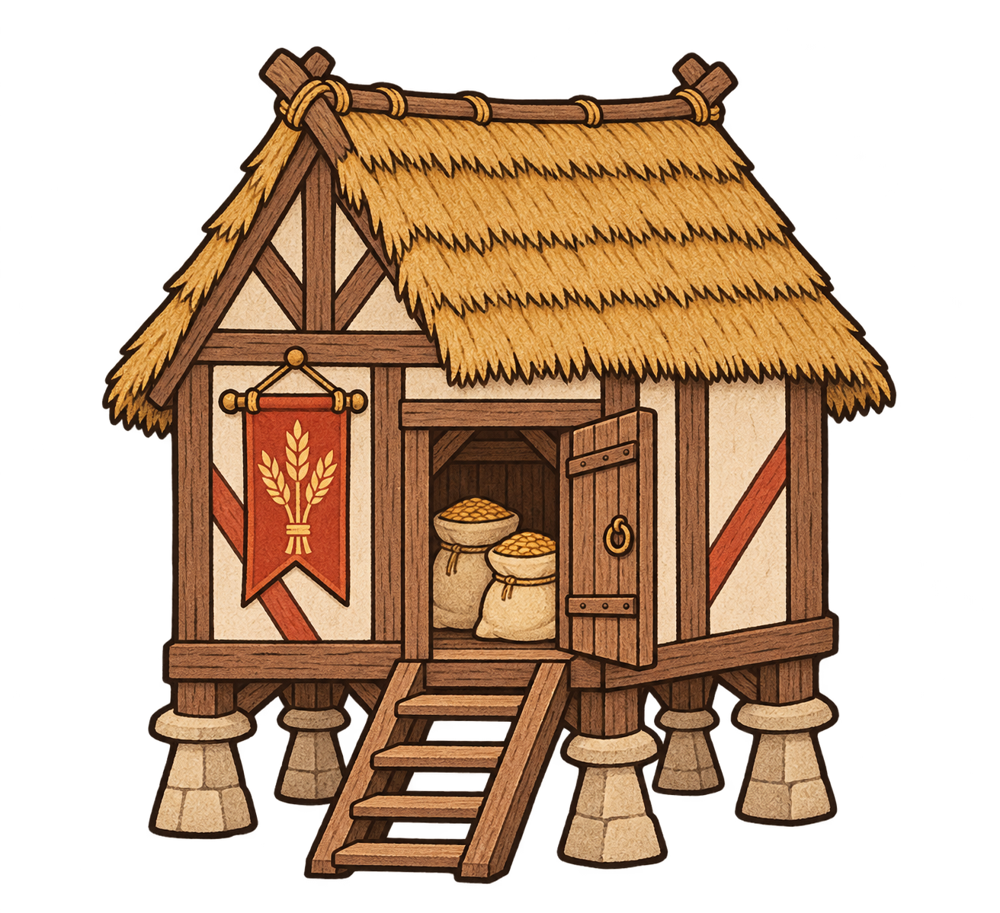
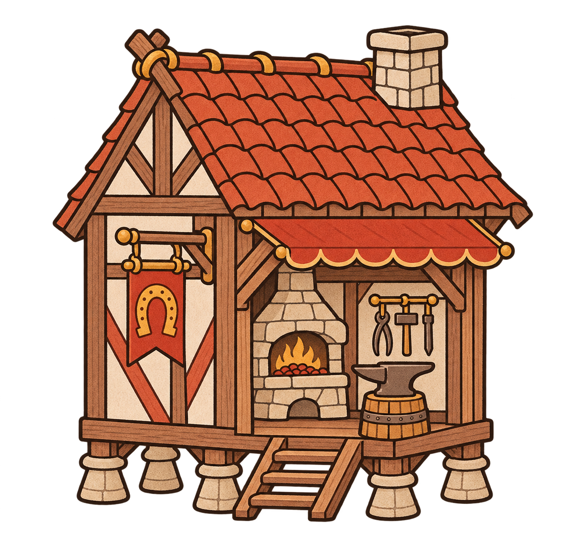
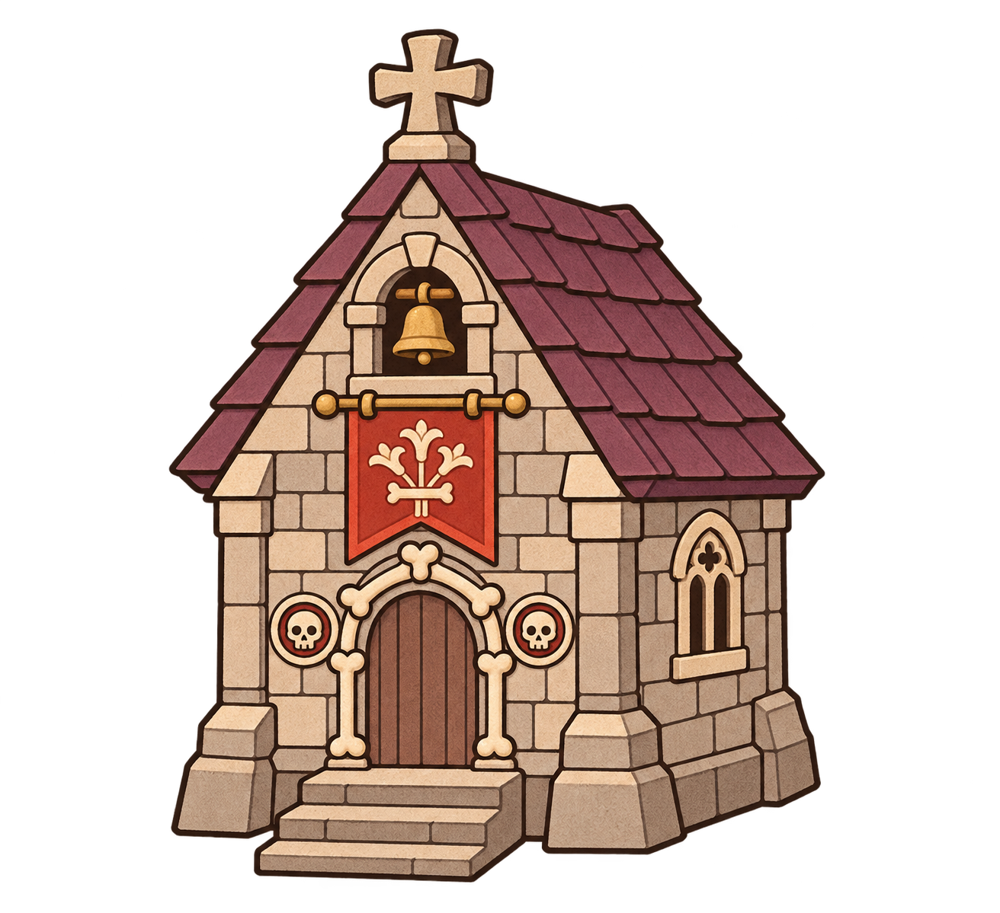
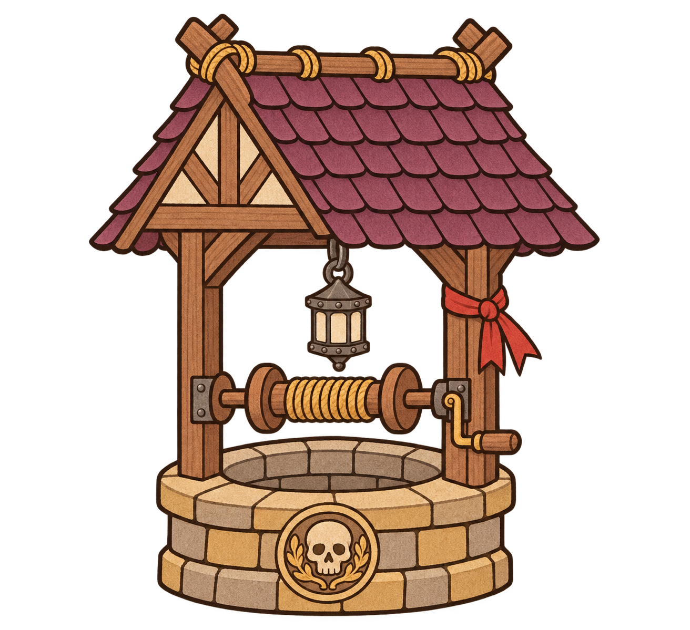
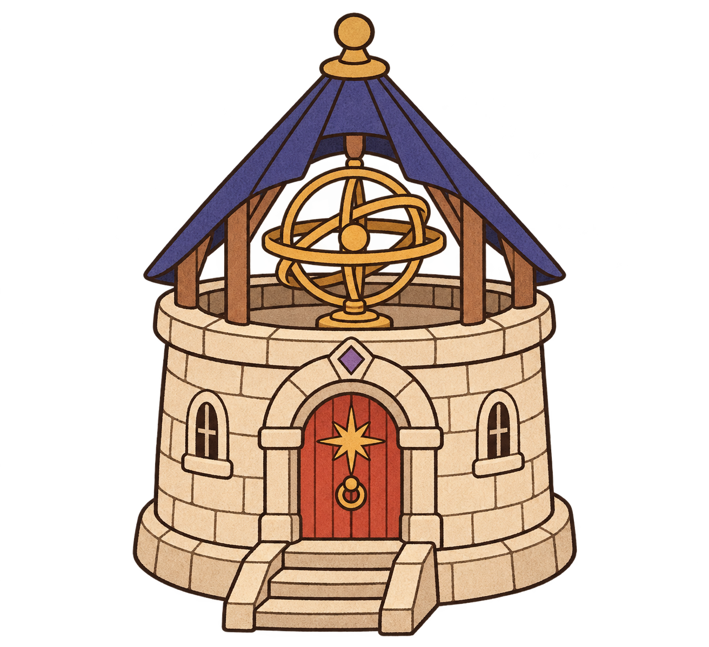
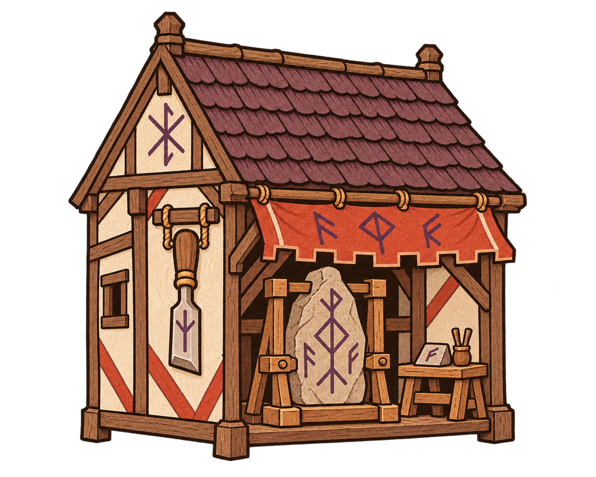
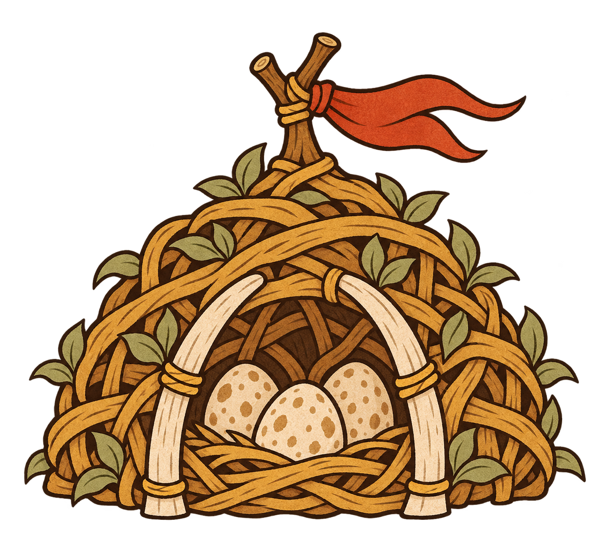
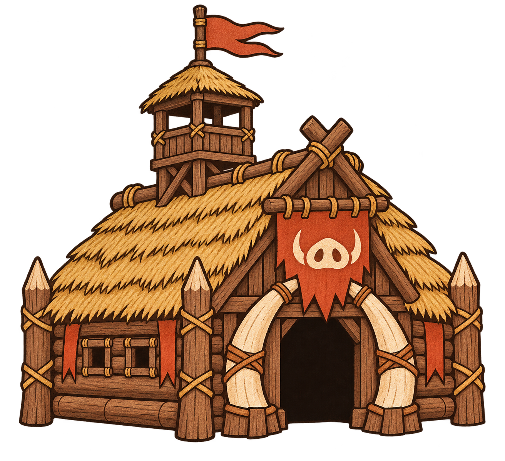

# 手抄本新建築素材

2026-11-13，使用內建 image_gen 生成。八張獨立 PNG，以專案 `assets/manuscript-v1/building-ui-prompts.json` 及 `mill.png` 作提示詞與畫風來源。糧倉再作重畫版的直接風格參考。未覆蓋遊戲既有素材，未修改程式或數值。用途僅為提案。

已逐張目視檢查完整建築與畫風；尚待 70–80px 顯示、透明邊緣與隊色驗收。鐵匠鋪重畫後採高腳形式；引魂井的燈籠與捲軸連接仍需整合時確認。星象儀環間也需檢查透明像素。

## 糧倉

用途構想：經濟儲備。

### 提示詞

Production 2D game sprite for FiveLaneLords, medieval illuminated manuscript. Reference mill is STYLE ONLY, design a NEW BUILDING. Bold dark brown INK CONTOURS, flat matte gouache shapes, minimal hatching and restrained pigment, ivory ochre brown muted vermilion palette. Match original mill illustration technique, not photorealism or 3D. One isolated building, slightly elevated three-quarter view, COMPLETE silhouette, generous margin. True TRANSPARENT background, no scenery, ground slab, cast shadows, glow, smoke, haze, lettering, frames or people. Readable at 80px. Every part of building inside canvas. Vermilion cloth/banner for team recolor. NORMAL FACTION GRAIN GRANARY: squat timber-framed storehouse on six short stone rat-proof staddle posts, ivory plaster walls, simple ochre thatch gable roof, small wooden access stair, two grain sacks visible through open doorway, red hanging wheat-emblem pennant without text. Broad compact silhouette, no windmill sails.

## 野戰鐵匠鋪

用途構想：裝備支援。

### 提示詞

Draw a NEW medieval FIELD SMITHY in precisely the supplied granary's flat HAND-DRAWN 2D manuscript style: bold dark-brown outline ink, large matte red/ivory/ochre color fills, minimal shading, restrained pigment inside shapes only. Compact timber-frame workshop with red tile roof, square short chimney, open bay containing simple stone forge and anvil, horseshoe sign and red awning. No people. Complete building with ample padding, slightly elevated three-quarter view, on TRUE TRANSPARENT empty background. No ground, shadows, halo, haze, scenery, frame or text. No photography, 3D or realistic surface rendering. Match reference DRAWING and contour thickness exactly.

## 藏骨禮拜堂

用途構想：亡者召集。

### 提示詞

Draw one NEW OSSUARY CHAPEL building sprite, same bold dark-brown ink contours and FLAT MATTE gouache illustration style as reference granary. Compact squat ivory-grey stone chapel, muted plum steep roof, small bell opening, sealed arched doorway decorated with simple ivory bone trim and two small skull medallions, vermilion funeral banner. Slightly elevated three-quarter view. All stones simplified DRAWN shapes, not realistic stone. Complete silhouette with wide empty TRANSPARENT margin. No parchment page or rectangular background, no decorative outer border, no scenery, ground, shadow or glow. One isolated 2D building only, no text or people, no 3D.

## 引魂井

用途構想：靈魂回收。

### 提示詞

Draw a NEW SOUL WELL game building in EXACT reference granary's bold ink-outlined FLAT 2D medieval manuscript style. A low circular ochre-grey masonry well with two timber supports and plum-shingled gable roof, wooden winch, single closed iron lantern suspended instead of bucket, one ivory skull medallion carved on rim, red ribbon on support. Flat paint shapes, brown ink contours on every beam and stone, minimal hatching, no realistic shading. Three-quarter slightly elevated view. TRUE TRANSPARENT background, empty spaces between posts also clear alpha, no courtyard, scenery, shadows, smoke, glow or haze. No text, border, people or ground slab. Whole structure visible, generous margin.

## 星象觀測所

用途構想：偵察與法術定位。

### 提示詞

Draw a NEW ASTROLOGER OBSERVATORY sprite in EXACT same flat hand-INKED 2D manuscript art style as reference granary. Squat round ivory stone tower with open indigo cone roof exposing simple ochre brass armillary sphere, red arched door, short steps, one small violet diamond over door. Brass rings are flat ochre shapes with dark-brown INK outlines, NO realistic metallic shading. All building surfaces flat matte gouache, minimal hatch and simplified masonry. Single entire building, slightly elevated three-quarter view, generous padding. TRUE TRANSPARENT background, no sky, stars, ground, shadow, glow, halo, haze, scenery, border or text. No realistic rendering or 3D.

## 符文工坊

用途構想：符印製作與修復。

### 提示詞

Production 2D game sprite for FiveLaneLords, medieval illuminated manuscript. Reference mill is STYLE ONLY, design a NEW BUILDING. Bold dark brown INK CONTOURS, flat matte gouache shapes, minimal hatching and restrained pigment, ivory ochre brown muted vermilion palette. Match original mill illustration technique, not photorealism or 3D. One isolated building, slightly elevated three-quarter view, COMPLETE silhouette, generous margin. True TRANSPARENT background, no scenery, ground slab, cast shadows, glow, smoke, haze, lettering, frames or people. Readable at 80px. Every part of building inside canvas. Vermilion cloth/banner for team recolor. MAGIC FACTION RUNE WORKSHOP: small medieval ochre timber and ivory plaster workshop, muted plum steep roof, open front displays one large engraved standing stone held in a wooden carving frame, a small wooden workbench, oversized carving chisel symbol hung on side, simple violet runes carved into stone and red canopy. All magical elements are opaque painted symbols, no lighting or glow. No person. Distinct rectangular craft building.

## 巨獸孵巢

用途構想：怪物孵育。

### 提示詞

Production 2D game sprite for FiveLaneLords, medieval illuminated manuscript. Reference mill is STYLE ONLY, design a NEW BUILDING. Bold dark brown INK CONTOURS, flat matte gouache shapes, minimal hatching and restrained pigment, ivory ochre brown muted vermilion palette. Match original mill illustration technique, not photorealism or 3D. One isolated building, slightly elevated three-quarter view, COMPLETE silhouette, generous margin. True TRANSPARENT background, no scenery, ground slab, cast shadows, glow, smoke, haze, lettering, frames or people. Readable at 80px. Every part of building inside canvas. Vermilion cloth/banner for team recolor. MONSTER FACTION BEAST HATCHERY: low dome-shaped nest shelter built of thick interwoven ochre branches and sage leaves, braced by two simple curved ivory ribs at entrance, three large speckled ivory eggs visible inside, vermilion cloth tied to top branch. Appears as a constructed monster den building, no living creatures, no separate ground patch, no gore, no surrounding forest. Bold simple nest silhouette.

## 獠牙戰寨

用途構想：怪物集結。

### 提示詞

Production 2D game sprite for FiveLaneLords, medieval illuminated manuscript. Reference mill is STYLE ONLY, design a NEW BUILDING. Bold dark brown INK CONTOURS, flat matte gouache shapes, minimal hatching and restrained pigment, ivory ochre brown muted vermilion palette. Match original mill illustration technique, not photorealism or 3D. One isolated building, slightly elevated three-quarter view, COMPLETE silhouette, generous margin. True TRANSPARENT background, no scenery, ground slab, cast shadows, glow, smoke, haze, lettering, frames or people. Readable at 80px. Every part of building inside canvas. Vermilion cloth/banner for team recolor. MONSTER FACTION TUSK WAR LODGE: squat crude log longhouse with ochre straw roof, stout palisade corner posts, two huge curved ivory tusks form arch over open black doorway, vermilion hide banner with simple boar-snout symbol, leather lashings and one small wooden roof lookout box. No inhabitants, no loose weapons outside, no terrain slab. Coherent compact monster barracks, drawn flat medieval bestiary architecture.

