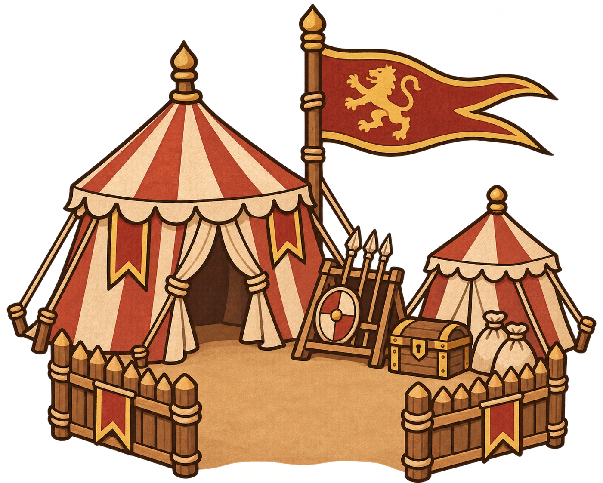
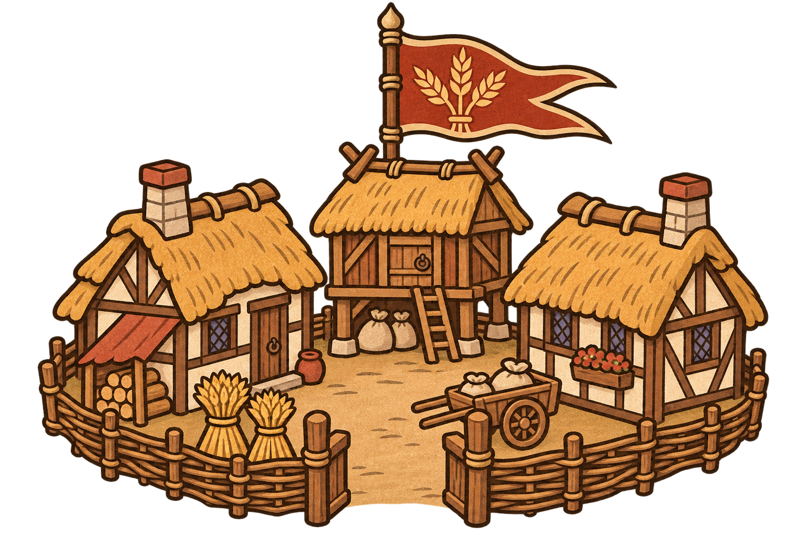
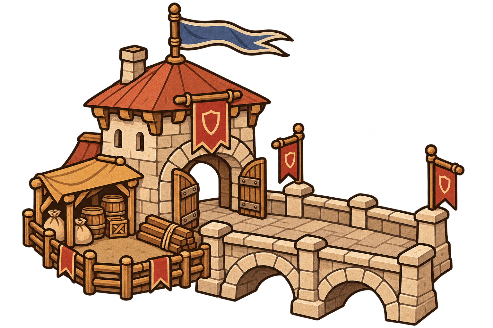
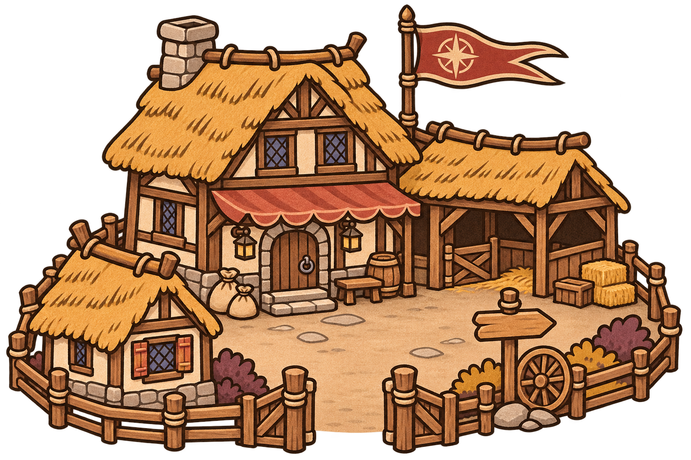
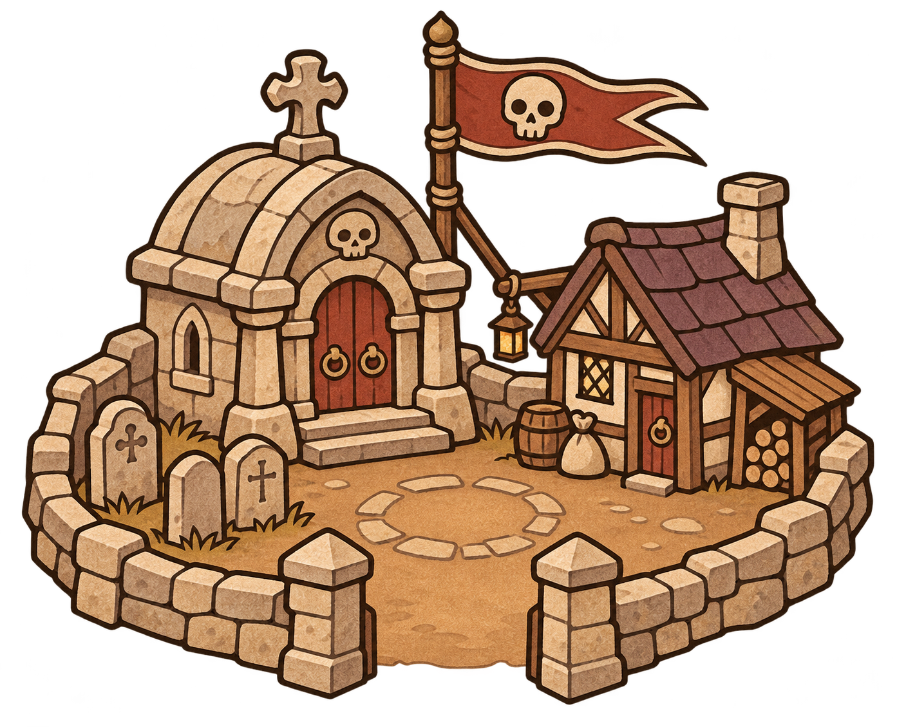
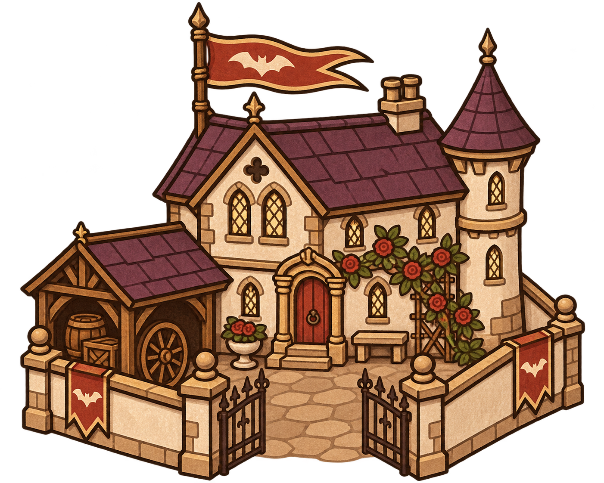

# 八位領主的駐守據點

目視結果：八處完整且具獨立輪廓；豐收、鐵壁、邊境三張仍有輪廓外棕灰霧光，只作概念圖，不能當作乾淨透明素材直接整合。其他圖片亦仍需逐像素透明邊緣驗收。鐵壁圖頂部旗幟生成为藍色，紅色盾旗保留，後續隊色需統一。停鐘學舍前門較窄、刻印石營院落較零碎，遊戲整合時需確認領主站位。

2026-11-13。使用內建 image_gen 生成，每位領主一張全新獨立 PNG。畫風依據原專案 `assets/manuscript-v1/adventure-prompts.json` 的村莊規格、`bandit-prompts.json` 的帳篷規格；圖像參照使用 `bandit-tent.png`。保留手抄本墨線、霧面顏料與緊湊聚落形態。

## 共用設計構想

這批是值得領主停留防守的地點。每處有入口、可容納守軍的院落與可辨識的物資或設施。設計提案為：領主在駐守範圍內且無敵軍爭奪時，逐步累積一項收益；離開停止，敵軍進入中斷。收益與冷卻尚未定數值，未修改遊戲玩法或程式。造型中沒有角色，方便在遊戲中另放守軍。

以下用途都是提案，並非目前已有機制。素材尚待遊戲尺寸、佔地、遮擋、透明邊緣與換色驗收。生成要求透明背景，是否達成須以逐張檢查為準。

## 紅獅領主：獅旗集結營

軍事帳棚與補給箱，輪廓低矮、獅旗高聳。價值在集結援軍；代價是領主離開前線。敵方可趁領主駐守時轉攻其他路。

### 完整提示詞

Production 2D gameplay asset for FiveLaneLords. Make a NEW compact GARRISONABLE POINT OF INTEREST, a small lived-in cluster rather than one generic tower. Reference tent is STYLE ONLY: EXACT same hand-drawn bold dark-brown ink contours, FLAT matte gouache, simplified medieval manuscript perspective and restrained pigment texture inside painted shapes. Warm ivory, ochre, brown, muted vermilion, limited indigo/plum. Single coherent compact settlement composition, slightly elevated three-quarter view; all roofs, fences, pennants fully visible with generous padding. Strong readable large silhouettes, details restrained for small game scale. Genuine TRANSPARENT background, no haze/halo/glow/shadow outside outlines, no landscape or rectangular terrain base, no outer frame, no text or people. Avoid photography, realistic material rendering and 3D. Only a small physically bounded courtyard between buildings is allowed; outside cluster is fully transparent.
LION LORD MUSTER CAMP: a compact cluster of one large vermilion-and-ivory striped command pavilion, one small matching supply tent, a simple wooden weapon rack and a closed supply chest. A tall red pennant with ONE gold lion silhouette is the focal marker. Short palisade wings frame an OPEN clearly accessible central mustering courtyard; military canvas silhouettes, no castle.

## 豐收領主：麥穗莊園

有居民住宅、糧倉與開放院落。價值在穩定補給；建議駐守才能保護累積的收成，離開後容易被劫掠。

### 完整提示詞

Production 2D gameplay asset for FiveLaneLords. Make a NEW compact GARRISONABLE POINT OF INTEREST, a small lived-in cluster rather than one generic tower. Reference tent is STYLE ONLY: EXACT same hand-drawn bold dark-brown ink contours, FLAT matte gouache, simplified medieval manuscript perspective and restrained pigment texture inside painted shapes. Warm ivory, ochre, brown, muted vermilion, limited indigo/plum. Single coherent compact settlement composition, slightly elevated three-quarter view; all roofs, fences, pennants fully visible with generous padding. Strong readable large silhouettes, details restrained for small game scale. Genuine TRANSPARENT background, no haze/halo/glow/shadow outside outlines, no landscape or rectangular terrain base, no outer frame, no text or people. Avoid photography, realistic material rendering and 3D. Only a small physically bounded courtyard between buildings is allowed; outside cluster is fully transparent.
HARVEST LORD WHEATSTEAD: compact grouping of two modest ivory half-timbered thatched cottages and one small raised granary around a shared open yard, two wheat sheaves and handcart at edge, low woven fence and wide open gateway. Vermilion wheat banner focal marker. Welcoming rural settlement with valuable stores; no windmill.

## 鐵壁領主：石橋關卡

用窄通道與短橋表現守住要衝的價值。駐守支援附近防線修復；收益偏防守，避免同時大量產金。

### 完整提示詞

Production 2D gameplay asset for FiveLaneLords. Make a NEW compact GARRISONABLE POINT OF INTEREST, a small lived-in cluster rather than one generic tower. Reference tent is STYLE ONLY: EXACT same hand-drawn bold dark-brown ink contours, FLAT matte gouache, simplified medieval manuscript perspective and restrained pigment texture inside painted shapes. Warm ivory, ochre, brown, muted vermilion, limited indigo/plum. Single coherent compact settlement composition, slightly elevated three-quarter view; all roofs, fences, pennants fully visible with generous padding. Strong readable large silhouettes, details restrained for small game scale. Genuine TRANSPARENT background, no haze/halo/glow/shadow outside outlines, no landscape or rectangular terrain base, no outer frame, no text or people. Avoid photography, realistic material rendering and 3D. Only a small physically bounded courtyard between buildings is allowed; outside cluster is fully transparent.
IRON LORD BRIDGE CHECKPOINT: one very SHORT stout stone bridge with two broad readable arches, attached squat gatehouse on one end, low stone parapets, red shield banner and stacked repair timber. A small supply shelter beside entry. Traversable bridge deck and open gate clearly visible. Isolated compact tactical point; no river, landscape or grand castle.

## 邊境領主：邊境驛村

驛站、旅舍與空馬廄構成可停留的村落。駐守取得補給或情報，適合冒險支線；不直接取代戰鬥輸出。

### 完整提示詞

Production 2D gameplay asset for FiveLaneLords. Make a NEW compact GARRISONABLE POINT OF INTEREST, a small lived-in cluster rather than one generic tower. Reference tent is STYLE ONLY: EXACT same hand-drawn bold dark-brown ink contours, FLAT matte gouache, simplified medieval manuscript perspective and restrained pigment texture inside painted shapes. Warm ivory, ochre, brown, muted vermilion, limited indigo/plum. Single coherent compact settlement composition, slightly elevated three-quarter view; all roofs, fences, pennants fully visible with generous padding. Strong readable large silhouettes, details restrained for small game scale. Genuine TRANSPARENT background, no haze/halo/glow/shadow outside outlines, no landscape or rectangular terrain base, no outer frame, no text or people. Avoid photography, realistic material rendering and 3D. Only a small physically bounded courtyard between buildings is allowed; outside cluster is fully transparent.
FRONTIER LORD WAYSTATION HAMLET: small timber coaching inn with ochre thatch roof and red cloth awning, attached open stable with one empty stall, a single smaller cottage, wooden signpost with NO writing and cartwheel. Cluster around a clear open arrival yard. Red compass-rose pennant marker. Rugged inviting border settlement; no horses or people.

## 冥府領主：守墓人聚落

墓穴與守墓小屋構成亡者集結點。駐守維持招魂進度，敵軍進入可打斷；避免無限被動出兵。

### 完整提示詞

Production 2D gameplay asset for FiveLaneLords. Make a NEW compact GARRISONABLE POINT OF INTEREST, a small lived-in cluster rather than one generic tower. Reference tent is STYLE ONLY: EXACT same hand-drawn bold dark-brown ink contours, FLAT matte gouache, simplified medieval manuscript perspective and restrained pigment texture inside painted shapes. Warm ivory, ochre, brown, muted vermilion, limited indigo/plum. Single coherent compact settlement composition, slightly elevated three-quarter view; all roofs, fences, pennants fully visible with generous padding. Strong readable large silhouettes, details restrained for small game scale. Genuine TRANSPARENT background, no haze/halo/glow/shadow outside outlines, no landscape or rectangular terrain base, no outer frame, no text or people. Avoid photography, realistic material rendering and 3D. Only a small physically bounded courtyard between buildings is allowed; outside cluster is fully transparent.
UNDERWORLD LORD GRAVEKEEPER SETTLEMENT: squat stone crypt, one tiny timber caretaker cottage with muted plum roof, three simple upright grave markers enclosed by low stone wall with OPEN gateway, single ivory skull medallion on red pennant. Clear central open ritual yard. Gentle non-gory medieval graveyard hamlet, no ghosts, haze or exposed bodies.

## 吸血領主：暮薔薇莊園

莊園、車棚與薔薇庭院表現受領主庇護的聚落。駐守提供精銳休整或血契儲備；不建議無條件永久疊生命。

### 完整提示詞

Production 2D gameplay asset for FiveLaneLords. Make a NEW compact GARRISONABLE POINT OF INTEREST, a small lived-in cluster rather than one generic tower. Reference tent is STYLE ONLY: EXACT same hand-drawn bold dark-brown ink contours, FLAT matte gouache, simplified medieval manuscript perspective and restrained pigment texture inside painted shapes. Warm ivory, ochre, brown, muted vermilion, limited indigo/plum. Single coherent compact settlement composition, slightly elevated three-quarter view; all roofs, fences, pennants fully visible with generous padding. Strong readable large silhouettes, details restrained for small game scale. Genuine TRANSPARENT background, no haze/halo/glow/shadow outside outlines, no landscape or rectangular terrain base, no outer frame, no text or people. Avoid photography, realistic material rendering and 3D. Only a small physically bounded courtyard between buildings is allowed; outside cluster is fully transparent.
VAMPIRE LORD DUSK ROSE MANOR: small two-storey ivory plaster manor with plum gable roof and one modest corner turret, attached low carriage shed, a compact red-rose trellis and iron gate standing OPEN onto sheltered entrance court. Vermilion pennant with simple ivory bat emblem. Aristocratic lived-in estate, not giant gothic castle, no blood or people.

## 法師領主：停鐘學舍

相連學舍與停鐘塔構成研究院。駐守累積一次性時空支援；不自動縮短全場時間，避免改變暫停與技能規則。

### 完整提示詞

Production 2D gameplay asset for FiveLaneLords. Make a NEW compact GARRISONABLE POINT OF INTEREST, a small lived-in cluster rather than one generic tower. Reference tent is STYLE ONLY: EXACT same hand-drawn bold dark-brown ink contours, FLAT matte gouache, simplified medieval manuscript perspective and restrained pigment texture inside painted shapes. Warm ivory, ochre, brown, muted vermilion, limited indigo/plum. Single coherent compact settlement composition, slightly elevated three-quarter view; all roofs, fences, pennants fully visible with generous padding. Strong readable large silhouettes, details restrained for small game scale. Genuine TRANSPARENT background, no haze/halo/glow/shadow outside outlines, no landscape or rectangular terrain base, no outer frame, no text or people. Avoid photography, realistic material rendering and 3D. Only a small physically bounded courtyard between buildings is allowed; outside cluster is fully transparent.
TIME MAGE LORD STILL-CLOCK COLLEGE: compact pair of ivory timber scholarly houses with indigo roofs joined by a low open archway, one small round clock face with plain hands and NO numerals on roof turret, outdoor reading lectern and rolled charts under red awning. Clear open shared study courtyard. Red hourglass pennant marker, no floating objects or effects.

## 符文領主：刻印石營

刻石與工匠帳棚構成作業營地。駐守累積法陣材料，離開後停止；部署仍需遵守現有領地與空格規則。

### 完整提示詞

Production 2D gameplay asset for FiveLaneLords. Make a NEW compact GARRISONABLE POINT OF INTEREST, a small lived-in cluster rather than one generic tower. Reference tent is STYLE ONLY: EXACT same hand-drawn bold dark-brown ink contours, FLAT matte gouache, simplified medieval manuscript perspective and restrained pigment texture inside painted shapes. Warm ivory, ochre, brown, muted vermilion, limited indigo/plum. Single coherent compact settlement composition, slightly elevated three-quarter view; all roofs, fences, pennants fully visible with generous padding. Strong readable large silhouettes, details restrained for small game scale. Genuine TRANSPARENT background, no haze/halo/glow/shadow outside outlines, no landscape or rectangular terrain base, no outer frame, no text or people. Avoid photography, realistic material rendering and 3D. Only a small physically bounded courtyard between buildings is allowed; outside cluster is fully transparent.
RUNE LORD INSCRIBERS ENCAMPMENT: one ochre canvas craft pavilion and two small thick standing stones engraved with simple opaque violet geometric runes, wooden carving bench and neatly stacked blank tablets, low timber fence with OPEN entry and central work yard. Red diamond-rune pennant marker. Physical working camp, no glowing circles, portals, wisps or magical haze.
