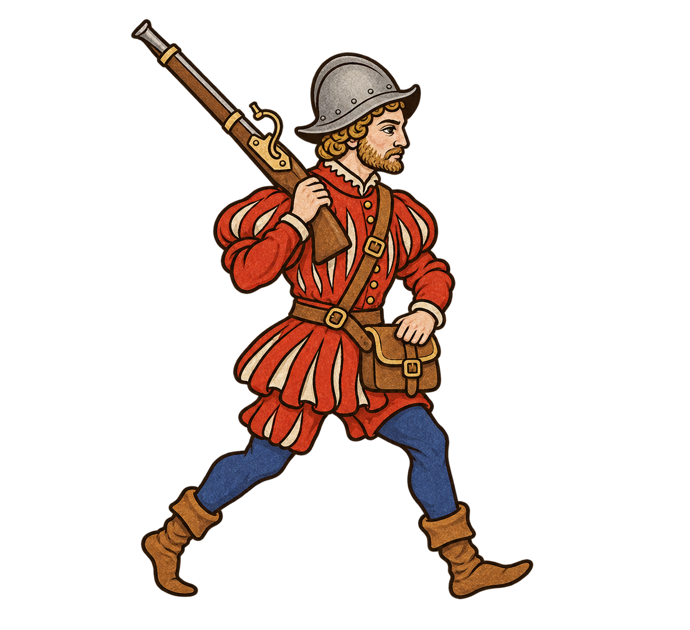
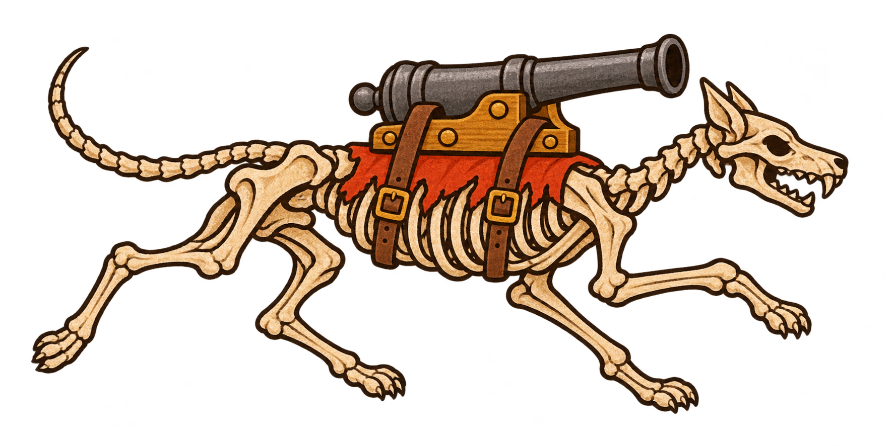
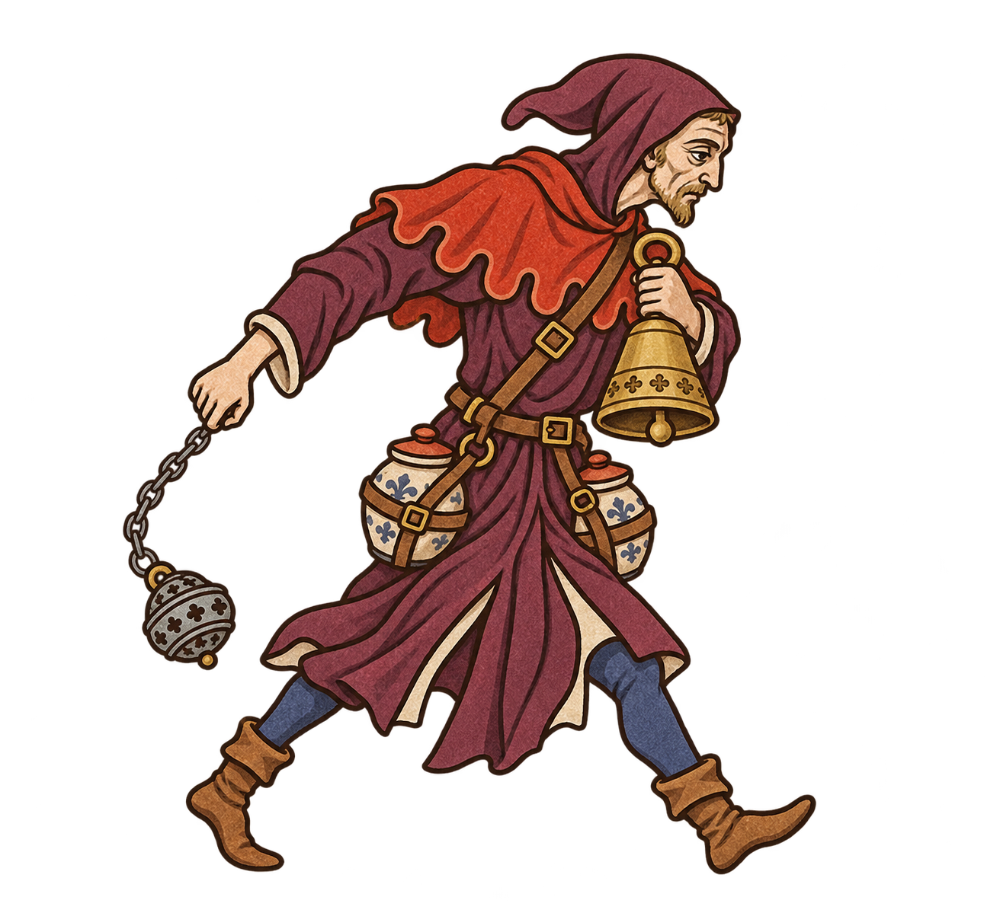
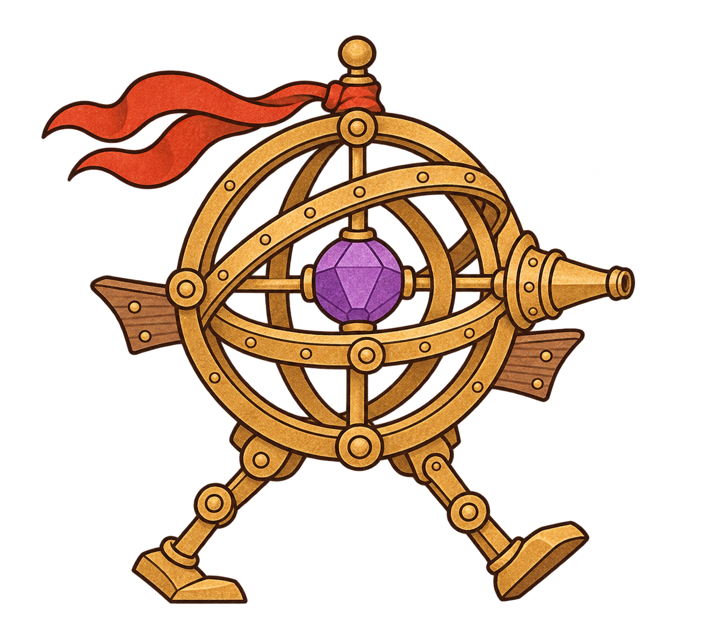
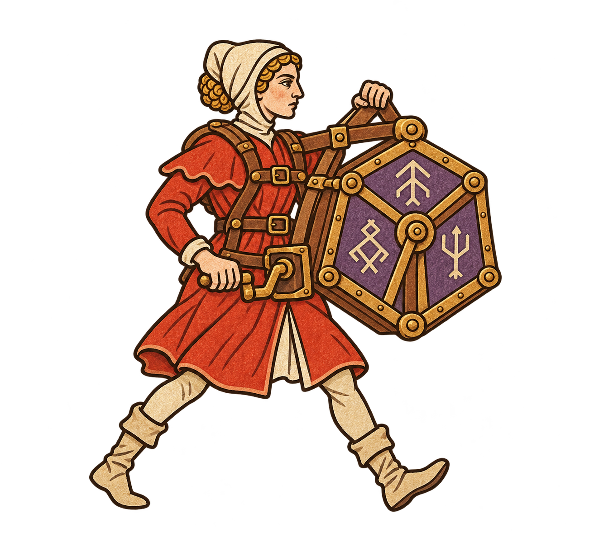
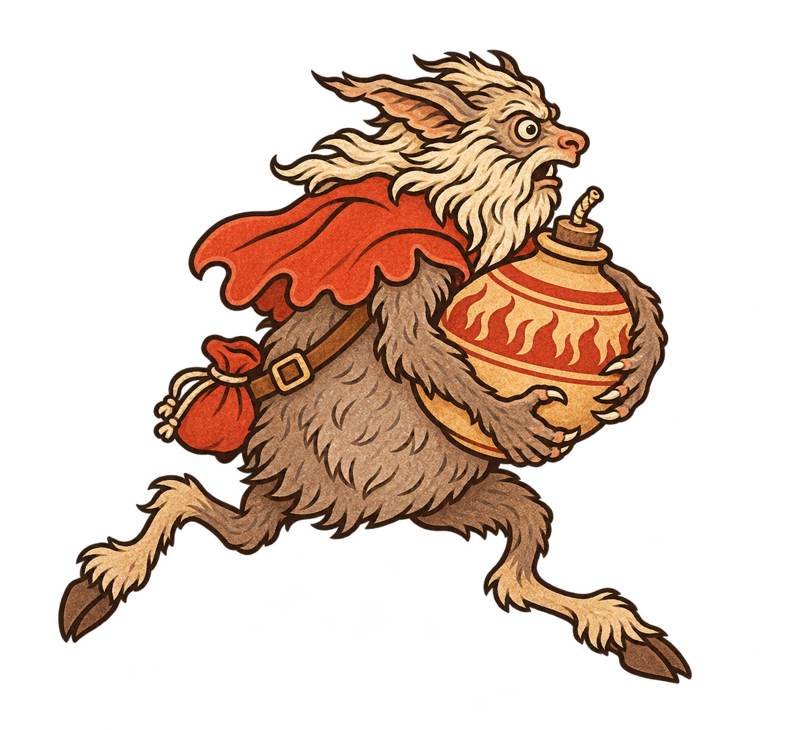

# 火器時代：可移動兵種選稿

內建 image_gen 生成，沿用 FiveLaneLords 原獵戶圖的墨線與平面顏料畫風。依使用者修正，陣營需有不同構造與姿態；全數為行進或奔跑姿態，裝備由身體承載，不使用落地盾牌或固定砲架。這些是單張姿態素材，尚未製作移動動畫，也未加入遊戲。

本次實際刪除 11 張淘汰圖：首批八張、被替換的移靈骨砲，以及帶明顯外圍霧光的短銃輕騎與火藥嗝獸。這份選稿只保留六張；各陣營張數不強行湊齊。

## 經典：行軍火繩槍兵

隊列火力、裝填空窗；用途為設計提案。

### 完整提示詞

NEW MOVING UNIT sprite for FiveLaneLords. Match original hunter STYLE ONLY: medieval illuminated manuscript, bold dark-brown hand-ink contour, FLAT matte gouache, muted ochre ivory vermilion indigo, limited flat shading, restrained pigment only inside silhouettes. No realistic render, no 3D. Full body facing RIGHT, explicitly ACTIVE WALKING/RUNNING stride with clear separated legs, gear carried with believable straps/grips. True transparent background, no floor/contact shadow/glow/haze/smoke/text/frame/extra poses. 8% margin all sides, entire gear and feet visible. NOT standing in static firing stance. NO planted shield, pavise, bipod, ground-mounted weapon, installation, scenery or loose props. Broad vermilion faction-color cloth where appropriate. Each faction must have unique body structure, prop and silhouette; never just a reskinned musketeer.
One human professional matchlock infantryman in red slashed doublet, plain steel morion, blue hose, boots. WALKING RIGHT with front knee bent and rear heel lifted. Carries long early matchlock slanted upright over RIGHT shoulder, right hand around stock at shoulder; left hand steadies a closed ammunition satchel at waist. Face profile visible. Standard organized military appearance. No shield.

## 黑暗：骷髏狗扛砲

四足奔跑的犬骨架，以皮帶與背架承載短砲。

### 完整提示詞

Create ONE skeletal DOG carrying a small cannon, a mobile dark-faction sprite for FiveLaneLords. STYLE reference hunter ONLY: bold clean dark-brown ink outline, flat matte ivory/ochre/vermilion gouache, minimal hatch and restrained pigment, medieval manuscript marginalia, no realistic rendering or 3D. A recognizable RUNNING DOG skeleton facing RIGHT: elongated CANINE skull with dog muzzle and pointed canine teeth, natural dog neck, dog rib cage, pelvis, exactly FOUR digitigrade canine legs in galloping stride ending in DOG PAWS (not hands), long curved bony tail. Back carries ONE short compact iron cannon in a small ochre wooden cradle secured by TWO leather girth straps around ribs; muzzle points right above and beyond head without touching skull. Small ragged vermilion saddlecloth under cradle. Low long agile dog silhouette, no humanoid skull, no human limbs, no antlers, no riders. Full body, cannon, tail and paws inside 8% padding. Genuine TRANSPARENT background, absolutely NO haze, glow, shadow, ground, text, smoke or scenery. Entire equipment carried on dog, no stationary supports.

## 黑暗：喪鐘擲彈使

移動投彈、儀式干擾；用途為設計提案。

### 完整提示詞

NEW MOVING UNIT sprite for FiveLaneLords. Match original hunter STYLE ONLY: medieval illuminated manuscript, bold dark-brown hand-ink contour, FLAT matte gouache, muted ochre ivory vermilion indigo, limited flat shading, restrained pigment only inside silhouettes. No realistic render, no 3D. Full body facing RIGHT, explicitly ACTIVE WALKING/RUNNING stride with clear separated legs, gear carried with believable straps/grips. True transparent background, no floor/contact shadow/glow/haze/smoke/text/frame/extra poses. 8% margin all sides, entire gear and feet visible. NOT standing in static firing stance. NO planted shield, pavise, bipod, ground-mounted weapon, installation, scenery or loose props. Broad vermilion faction-color cloth where appropriate. Each faction must have unique body structure, prop and silhouette; never just a reskinned musketeer.
One gaunt adult funeral-bell acolyte STRIDING RIGHT, plum robe split at knees revealing both boots, red scalloped mantle. Right arm swings a small iron incense-grenade hanging from SHORT chain, left arm holds brass funeral bell against chest. Two closed ceramic projectile jars in visible waist harness. Ritual procession silhouette with swinging chain and stooped neck, NO gun of any sort, no thrown/exploding object, no smoke/glow. Entire chain arc within frame, two connected arms.

## 魔法：星儀行砲

蓄能投射、步行砲台；用途為設計提案。

### 完整提示詞

NEW MOVING UNIT sprite for FiveLaneLords. Match original hunter STYLE ONLY: medieval illuminated manuscript, bold dark-brown hand-ink contour, FLAT matte gouache, muted ochre ivory vermilion indigo, limited flat shading, restrained pigment only inside silhouettes. No realistic render, no 3D. Full body facing RIGHT, explicitly ACTIVE WALKING/RUNNING stride with clear separated legs, gear carried with believable straps/grips. True transparent background, no floor/contact shadow/glow/haze/smoke/text/frame/extra poses. 8% margin all sides, entire gear and feet visible. NOT standing in static firing stance. NO planted shield, pavise, bipod, ground-mounted weapon, installation, scenery or loose props. Broad vermilion faction-color cloth where appropriate. Each faction must have unique body structure, prop and silhouette; never just a reskinned musketeer.
One animated medieval BRASS ARMILLARY AUTOMATON WALKING RIGHT: large round physical brass armillary sphere torso with three thick nested rings and small violet opaque crystal center, two short jointed ochre metal legs ending in broad flat feet in a clear walking stride. Two small wooden stabilizer fins at sides, red cloth ribbon securely attached to ring hub. A single short forward-pointing conical brass emitter built into sphere, no rifle, no human, no hands. Geometric circle-dominant silhouette, no modern robot detailing, no floating pieces or magical glow.

## 魔法：符印輪轂師

行進蓄印、扇形投射；用途為設計提案。

### 完整提示詞

NEW MOVING UNIT sprite for FiveLaneLords. Match original hunter STYLE ONLY: medieval illuminated manuscript, bold dark-brown hand-ink contour, FLAT matte gouache, muted ochre ivory vermilion indigo, limited flat shading, restrained pigment only inside silhouettes. No realistic render, no 3D. Full body facing RIGHT, explicitly ACTIVE WALKING/RUNNING stride with clear separated legs, gear carried with believable straps/grips. True transparent background, no floor/contact shadow/glow/haze/smoke/text/frame/extra poses. 8% margin all sides, entire gear and feet visible. NOT standing in static firing stance. NO planted shield, pavise, bipod, ground-mounted weapon, installation, scenery or loose props. Broad vermilion faction-color cloth where appropriate. Each faction must have unique body structure, prop and silhouette; never just a reskinned musketeer.
One adult female rune-engineer WALKING RIGHT in red knee-length coat, ivory coif and boots. Carries a vertical large wooden-and-brass hexagonal SEAL WHEEL in a chest-and-back leather harness, wheel physically attached alongside shoulder, three broad violet engraved glyph panels. Right hand turns a short crank at waist; left supports harness crossbar. No rifle, no gunstock, no floating symbols, no glow. Tall hexagonal silhouette and hand-crank action, both legs unobscured and in stride.

## 魔物：竊火鬍子魔

奔跑突襲、爆罐投擲；用途為設計提案。

### 完整提示詞

NEW MOVING UNIT sprite for FiveLaneLords. Match original hunter STYLE ONLY: medieval illuminated manuscript, bold dark-brown hand-ink contour, FLAT matte gouache, muted ochre ivory vermilion indigo, limited flat shading, restrained pigment only inside silhouettes. No realistic render, no 3D. Full body facing RIGHT, explicitly ACTIVE WALKING/RUNNING stride with clear separated legs, gear carried with believable straps/grips. True transparent background, no floor/contact shadow/glow/haze/smoke/text/frame/extra poses. 8% margin all sides, entire gear and feet visible. NOT standing in static firing stance. NO planted shield, pavise, bipod, ground-mounted weapon, installation, scenery or loose props. Broad vermilion faction-color cloth where appropriate. Each faction must have unique body structure, prop and silhouette; never just a reskinned musketeer.
One existing-style BEARDED IMP RUNNING RIGHT, long ivory shaggy beard, snub animal muzzle, pointed tufted ears, round wild eyes, pear-shaped grey-brown furry torso, TWO long simian clawed arms and TWO bent goat-hoof legs. Broad red shoulder mantle. Both arms hug ONE large CLOSED ceramic firepot against belly in an awkward hurried sprint, pot has a short UNLIT fuse stopper; strapped small red pouch at back, no extra props. No gun, no musket, no shield, no wheels. Animal face and limbs, never dwarf or human. Strong asymmetric running silhouette.

## 驗收備註

六張已目視確認整體姿態、完整輪廓與裝備承載。狗骨架為風格化造型，犬頭帶裝飾性骨耳，非解剖標本；砲口未完全越過犬頭，開火動畫前需調整安全輪廓。符印輪轂師左手支撐位置與背架仍需實際縮小驗收。尚未逐像素驗證 alpha、隊色換色及 70–80px 可讀性。
