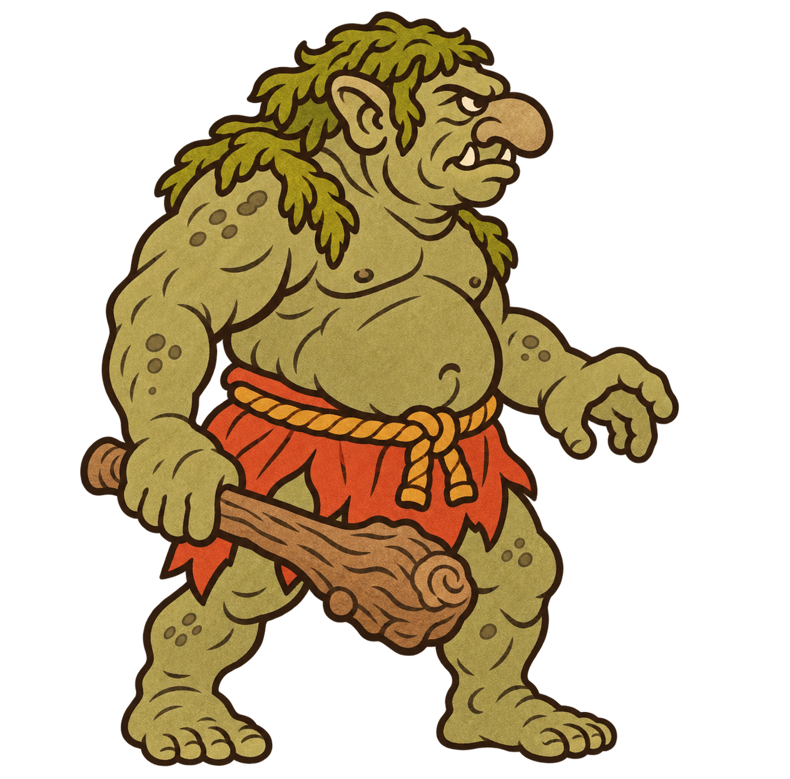
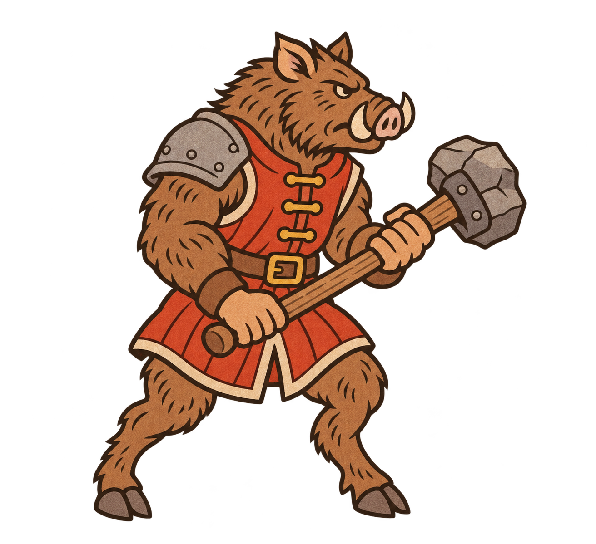
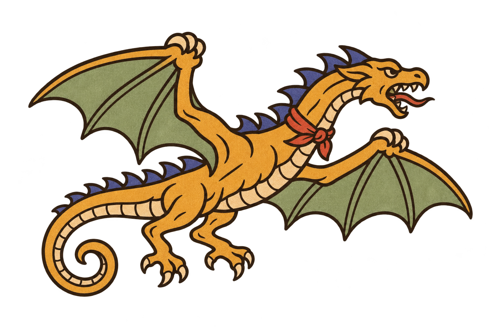

# 怪物陣營：新兵種概念

最終狀態：沼澤巨魔與獠牙野豬人可作素材候選；棘背翼獸經兩次修正仍有輪廓外霧光，僅保存為概念圖，尚非乾淨透明遊戲素材。勿直接整合翼獸；需另行修正透明邊緣。

翼獸第二次去霧仍未符合要求，因此重新生成，不以去霧版本作為定稿。重生成提示詞：undefined

目視驗收：巨魔、野豬人已確認全身與器具完整；翼獸首版輪廓外有霧光，因此追加清理。遊戲小尺寸與隊色換色仍待整合驗收。

翼獸清理提示詞：undefined

內建 image_gen 生成，風格參照沿用釘錘兵與專案原有手抄本規格。單張透明素材，尚未匯入遊戲；怪物陣營及能力均為設計提案，未修改 balance.gd。

## 沼澤巨魔

厚重近戰／再生方向：以木棒、寬厚身軀與苔綠皮膚辨識。

### 提示詞

undefined

## 獠牙野豬人

衝鋒破陣方向：以獠牙、蹄足與重槌辨識。

### 提示詞

undefined

## 棘背翼獸

空中襲擾方向：雙翼作前肢、兩條後腿，以棘背和長尾辨識。

### 提示詞

undefined

