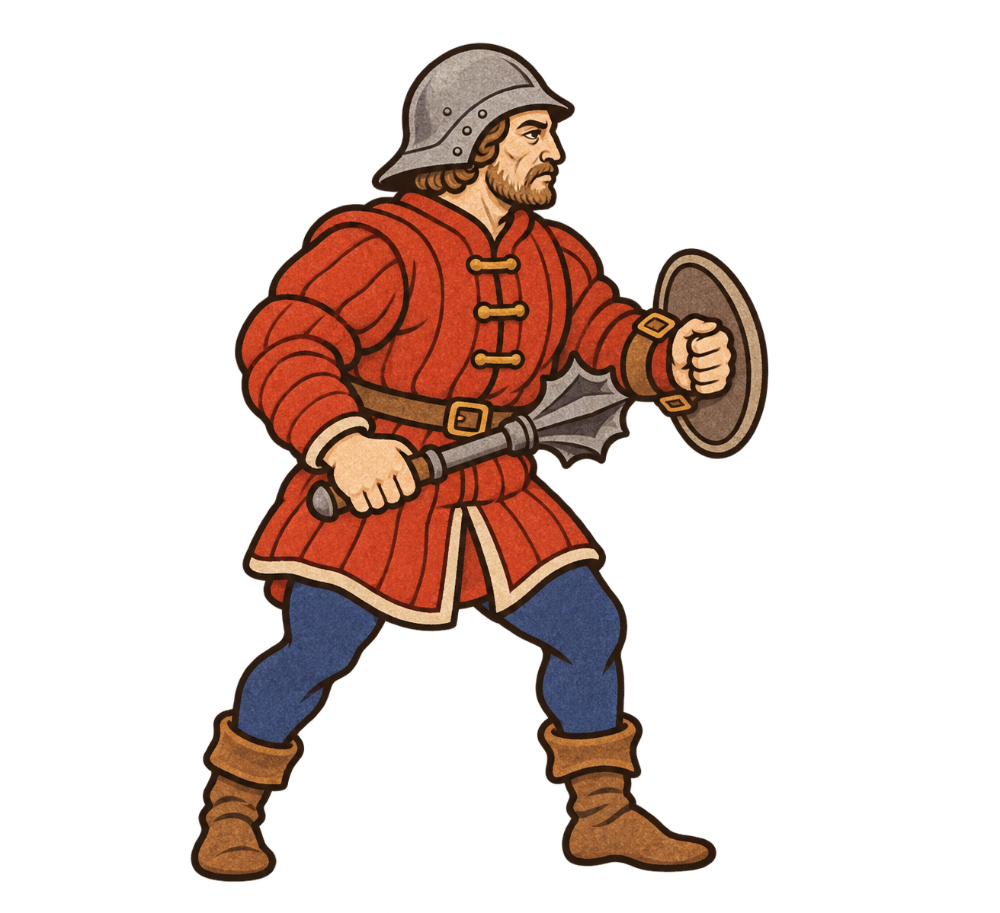
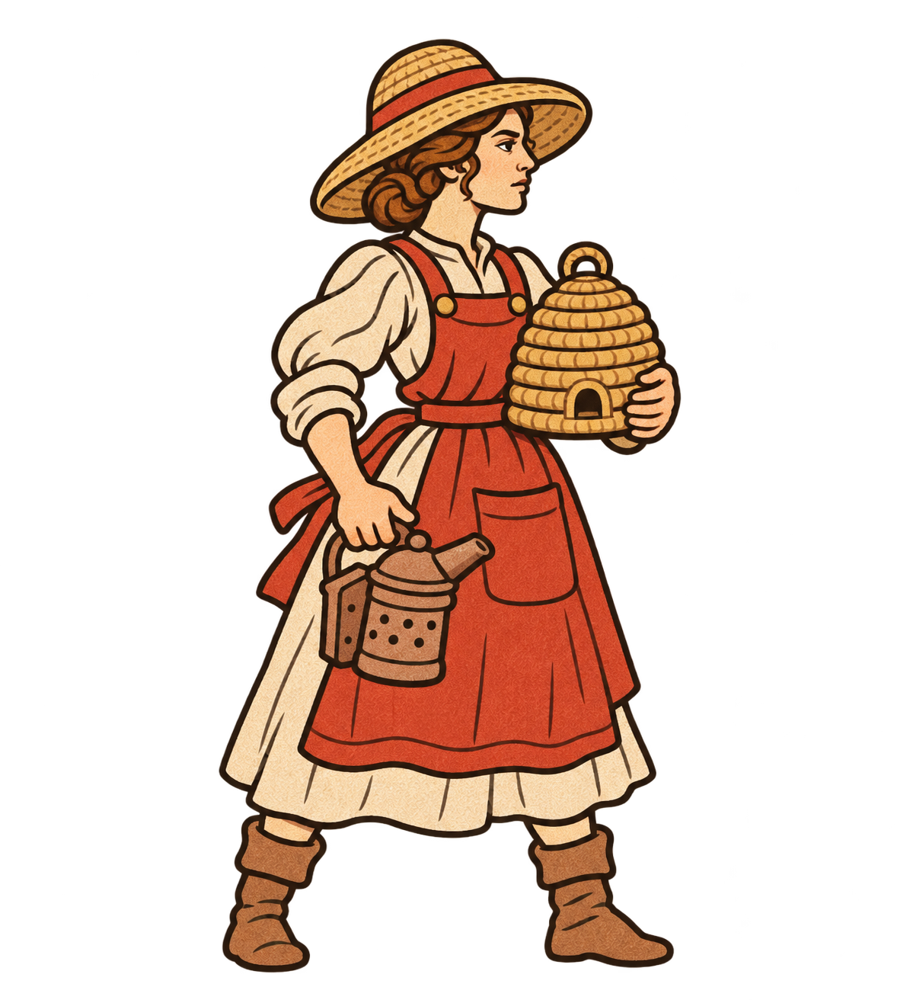
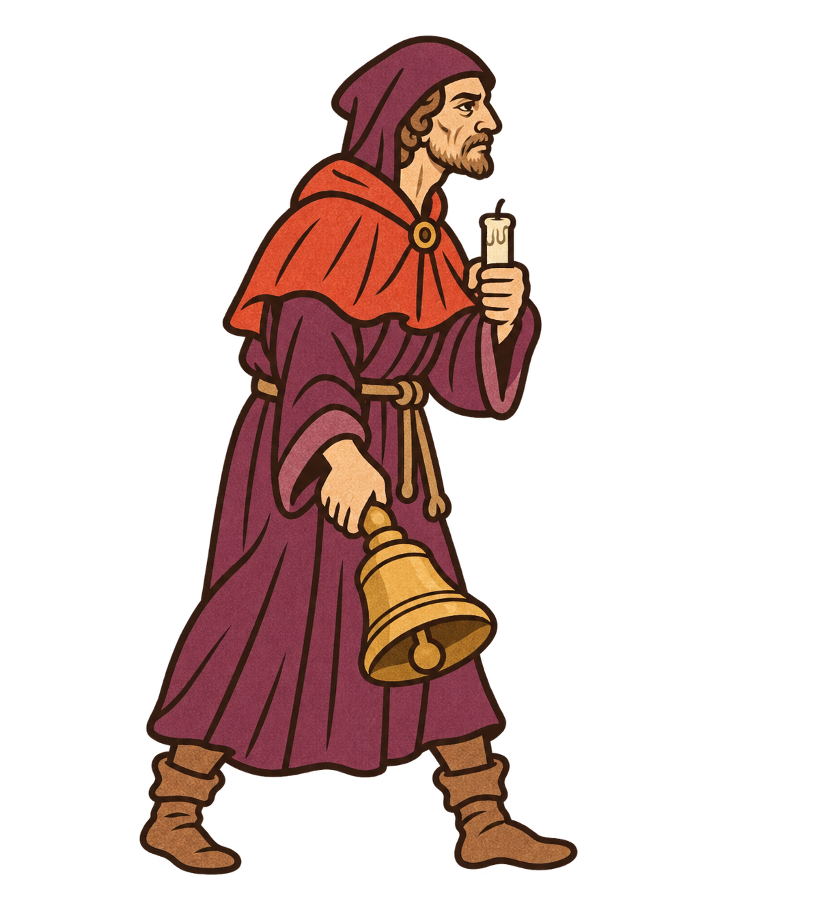
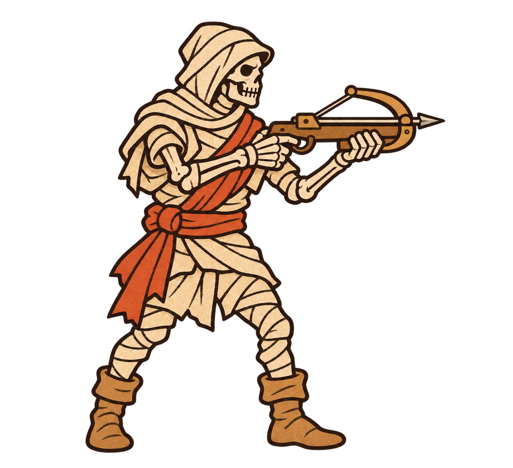
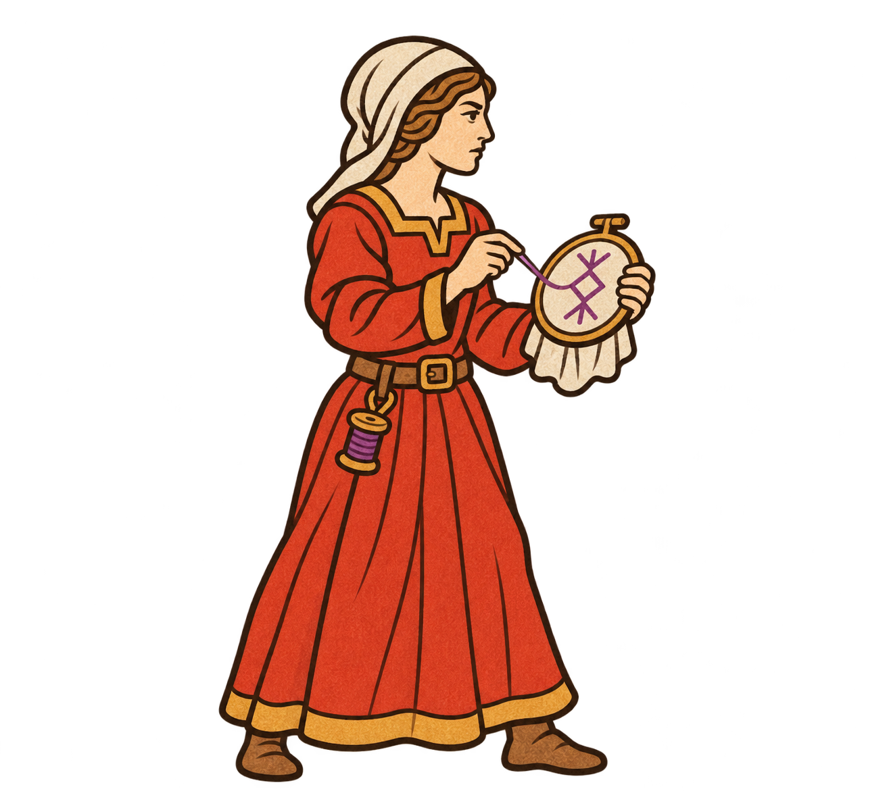
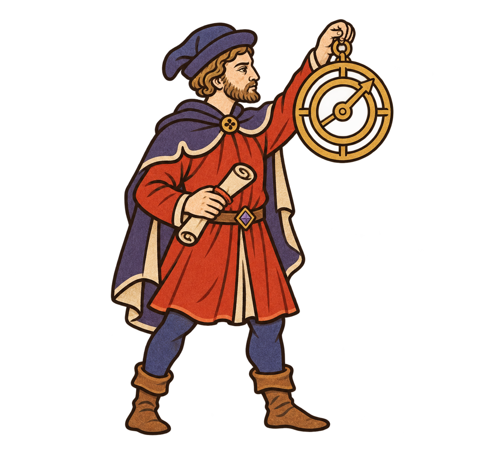

# 原畫風新兵種概念素材

生成方式：內建 image_gen。2026-11-13。六種全新兵種，每種一張透明 PNG，單人全身朝右。僅圖片與設計構想，未加入遊戲或設定數值。

## 專案原始提示詞

- `../FiveLaneLords/assets/manuscript-v1/character-prompts.json`
- `../FiveLaneLords/assets/manuscript-v1/faction-expansion-prompts.json`
- `../FiveLaneLords/assets/manuscript-v1/magic-units-prompts.json`

原圖風格參照：`hunter.png`、`necromancer.png`。釘錘兵作為後續四張重畫的直接風格參照。偏寫實的初次結果未選入此資料夾。前一批 troop-art-v2 為誤解要求的重製圖，不是本批。

美術原則：深褐墨線、大片霧面顏料、朱紅隊色、少量陰影與細節、完整裝備和腳部、透明背景。已目視檢查，尚未做 70–80 像素遊戲尺寸及換色驗收。釘錘兵盾牌採握持式小圓盾，與最初的前臂固定描述略有不同；養蜂人重畫版未保留面紗。

## 釘錘破甲兵（常規）

近戰破甲構想；釘錘與小圓盾。

### 最終提示詞

Production 2D sprite for FiveLaneLords medieval illuminated manuscript strategy game. Reference images are STYLE REFERENCES ONLY; create a NEW unit, do not redraw reference subject. Match reference hunter's adult sturdy proportions, restrained facial drawing, bold clean dark brown ink contours, large FLAT matte gouache shapes, very minimal hatching, restrained pigment texture INSIDE silhouette only. NO noisy grain, NO realistic anatomy rendering, NO metal reflections, NO dense armor details, NO cute chibi enlargement. Warm ivory, muted vermilion, indigo, ochre. One SINGLE full body character facing RIGHT in three quarter side view, entire equipment and feet visible, generous padding, readable at 70 pixels tall. Genuine transparent background, clean alpha, no scenery/base/shadows/text/borders/extra poses/glow. Exactly two anatomically connected arms and hands. NEW NORMAL FACTION: MACEBREAKER / 釘錘破甲兵. A stocky professional foot soldier in plain padded vermilion jack, simple open grey sallet, indigo hose and brown boots. Holds one short heavy flanged iron mace in right hand angled forward at waist, left hand braces a small plain buckler mounted to forearm. Broad blunt silhouette clearly different from swordsmen and spearmen. Minimal iron plates only. Calm determined weathered adult face.

## 養蜂人（常規）

區域干擾構想；蜂巢與燻蜂器。

### 最終提示詞

STYLE TRANSFER TO A NEW SUBJECT. The supplied reference is the EXACT required flat hand-drawn game sprite style. Draw a BEEKEEPER in this exact same dark-brown bold OUTLINED 2D ILLUSTRATION style. A single adult woman full body facing RIGHT, red apron, ivory dress, straw hat, holding small wicker bee skep and clay smoker. Simplified ink-drawn face like reference, flat matte red ochre ivory paint, clearly DRAWN fingers, simple brown boots. Transparent background, no background light or halo, no ground, no text, ample margin. Match the reference linework and flatness exactly. This must look illustrated by the same artist as the reference soldier. Do not create a photograph or realistic fabric/skin. No 3D. All body and props inside canvas.

## 送葬鐘使（黑暗）

亡者支援構想；喪鐘與未點燃蠟燭。

### 最終提示詞

Create one NEW FUNERAL BELLBEARER game sprite in EXACTLY the reference soldier's flat DRAWN 2D medieval illuminated manuscript art style. Same bold dark-brown ink outlines on face, hands, clothing, equipment; flat opaque gouache color fills. A gaunt adult sexton full body facing RIGHT, wearing plain plum robe and vermilion shoulder mantle, two visible boots. Right hand carries a large brass handbell down and forward, left hand holds a short unlit candle near chest. Entire bell and figure visible, generous transparent margin. Genuine transparent background. No lettering, no scenery, no atmospheric lighting, no ground, no photo or realistic material. Use simple graphic shapes with at most two tones each, hand-drawn adult face same as reference. New subject only, keep reference STYLE.

## 裹屍弩手（黑暗）

亡靈遠程構想；裹屍布與木弩。

### 最終提示詞

Create a NEW SHROUD CROSSBOWMAN sprite. EXACT same hand-drawn flat 2D ink-and-gouache illustration technique as reference, bold dark brown contours, simple flat vermilion ivory ochre plum shapes, adult sturdy proportions. A skeleton soldier in aged ivory linen wrappings and vermilion sash aiming a small wooden crossbow to RIGHT, full body three-quarter side view, two complete skeletal arms, right hand on trigger and left under wooden fore-end, two clear legs and boots. Simplified ink-drawn bones, not realistic bones. No material rendering, no photography or 3D, no cast shadow or glow. True transparent background. No text. Full equipment and body visible with generous margin. Match the reference drawing style exactly.

## 符印織師（魔法）

護盾／結界支援構想；符印繡框與紫線。

### 最終提示詞

Create a NEW SIGIL WEAVER sprite. EXACT same HAND DRAWN flat 2D illustration style as reference soldier: bold clean dark-brown contour ink lines, flat vermilion ochre ivory paint shapes, minimal hatching and subtle paint inside contours only. Single adult woman, FULL BODY facing RIGHT, ivory coif, simple red robe with ochre trim, visible brown shoes. Left hand holds small round embroidery hoop with ivory cloth, right hand draws one purple thread through a simple violet geometric rune stitched on cloth. Small thread spool at belt. Two connected arms. Simple graphic illustrated face, no realistic skin or fabric. Transparent background, generous padding, no text, no glow, no scenery or ground shadow. Same adult proportions, outline thickness and limited flat shading as reference.

## 星盤測繪師（魔法）

偵察／施法定位構想；星盤與測繪卷。

### 最終提示詞

Production 2D sprite for FiveLaneLords medieval illuminated manuscript strategy game. Reference images are STYLE REFERENCES ONLY; create a NEW unit, do not redraw reference subject. Match reference hunter's adult sturdy proportions, restrained facial drawing, bold clean dark brown ink contours, large FLAT matte gouache shapes, very minimal hatching, restrained pigment texture INSIDE silhouette only. NO noisy grain, NO realistic anatomy rendering, NO metal reflections, NO dense armor details, NO cute chibi enlargement. Warm ivory, muted vermilion, indigo, ochre. One SINGLE full body character facing RIGHT in three quarter side view, entire equipment and feet visible, generous padding, readable at 70 pixels tall. Genuine transparent background, clean alpha, no scenery/base/shadows/text/borders/extra poses/glow. Exactly two anatomically connected arms and hands. NEW MAGIC FACTION: ASTROLABE SURVEYOR / 星盤測繪師. Middle-aged scholar with short beard, vermilion knee-length tunic and modest cape, indigo hose, brown boots, soft medieval cap. Holds a large simple brass astrolabe vertically by its top ring in raised RIGHT hand in front of his face, LEFT hand supports a short rolled parchment chart at waist. Astrolabe has three bold concentric rings and one clear pointer, not intricate machinery. Small violet crystal belt clasp. Thoughtful practical expression. No staff, no hourglass, no stars floating outside, no text.
